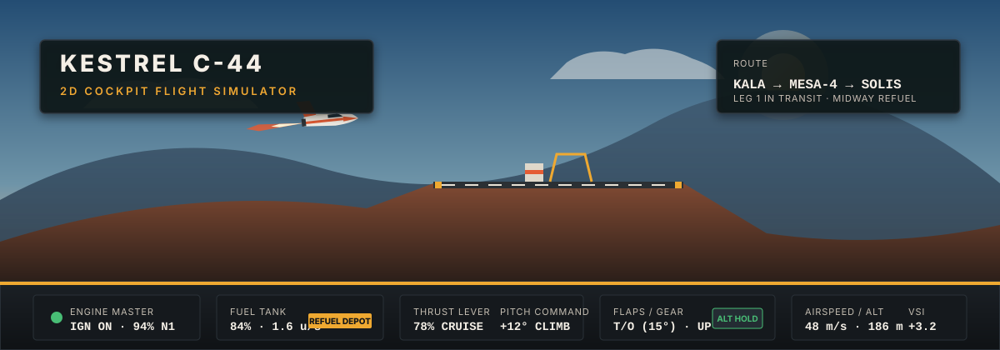
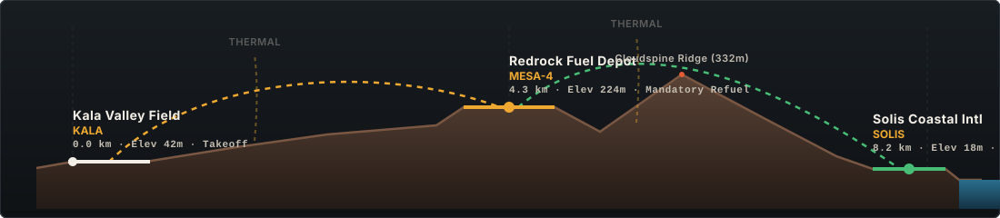

<p align="center">
  
</p>

<p align="center">
  <strong>A 2D sidescrolling flight simulator featuring a full physical cockpit console, realistic aerodynamics, and a mandatory midway canyon refueling stop.</strong>
</p>

<p align="center">
  <code>1-Handed Mouse Operation</code> &bull; <code>Procedural Physics</code> &bull; <code>Web Audio Synthesizer</code> &bull; <code>Zero External Dependencies</code>
</p>

<p align="center">
  <a href="https://thinkypadd.github.io/pilot-sim/"><strong>▶ Play Live in Browser on GitHub Pages</strong></a>
</p>

---

## ✦ Flight Plan & Route Profile

<p align="center">
  
</p>

The flight takes place across a continuous 8.8 km geographic corridor with distinct terrain elevations, ridge headwinds, and warm air thermals:

| Segment | Checkpoint | Elevation | Position | Mission Objective |
| :--- | :--- | :---: | :---: | :--- |
| **Departure** | `KALA` Kala Valley Field | `42 m` | `0.0 km` | Start turbine, set `T/O` flaps, release brakes, and climb |
| **Leg 1** | Foothills & Thermals | `95–180 m` | `0.0–3.8 km` | Cruise at 65–75% throttle; ride rising thermal drafts to conserve fuel |
| **Midway Stop** | `MESA-4` Redrock Fuel Depot | `224 m` | `4.3 km` | **Mandatory Landing**: Touchdown on elevated mesa, stop, and pump fuel |
| **Leg 2** | Cloudspine Ridge Climb | `332 m peak` | `5.8 km` | Engage full thrust or WEP afterburner to clear high terrain |
| **Arrival** | `SOLIS` Solis Coastal Intl | `18 m` | `8.2 km` | Descend along green PAPI glide path, deploy `LAND` flaps and stop on runway |

> [!IMPORTANT]
> **Fuel Economy Rule**: A full tank contains `100 units` of aviation fuel. Flying straight through to Solis at full power burns `~132 units`. Landing to top off tanks at **MESA-4** is required to complete the delivery without flameout.

---

## ✦ Cockpit Control Panel

The simulator features a complete physical aircraft console operated entirely with one hand using standard mouse clicks, drags, and wheel rolls.

```
┌────────────────────────────────────────────────────────────────────────────────────────────────────────┐
│ GLARESHIELD: [x] ENG ON  [x] FLAPS T/O  [x] BRAKES OFF  [ ] THRUST >80%  │ STALL · SINK · GEAR · FLAP   │
├───────────────┬───────────────────┬──────────────────────┬───────────────────────┬─────────────────────┤
│ ENGINE & FUEL │ THROTTLE QUADRANT │ ATTITUDE & ELEVATOR  │ FLAPS · GEAR · BRAKES │ FLIGHT DATA & RADAR │
│ ⏻ ENG MASTER  │ ▮ THRUST LEVER    │ ◉ ARTIFICIAL HORIZON │ [UP] [T/O] [LAND]     │ IAS:  48 m/s        │
│ ⟳ TURBINE RPM │   (0–100% + WEP)  │ ▮ PITCH LEVER        │ ◯ ◯ ◯ 3-GREENS GEAR   │ ALT:  186 m         │
│ ⛽ FUEL GAUGE │ ▮ SPOILER AIRBRAKE│ ⌖ 0° LVL DETENT      │ ⏻ WHEEL BRAKES        │ VSI:  +3.2 m/s      │
│ 🛢 REFUEL PUMP│   (0–100% DUMP)   │ ⚓ ALT HOLD SERVO     │   (PARKED / ARMED)    │ RADAR TERRAIN MAP   │
└───────────────┴───────────────────┴──────────────────────┴───────────────────────┴─────────────────────┘
```

### 1. Engine & Fuel Bay
- **ENG MASTER Switch**: Flip to ignition before pushing throttle.
- **Turbine N1 Gauge**: Shows live spool speed from idle (`22%`) to full throttle (`100%`).
- **Refuel Pump Button**: Unlocks only when brought to a full stop on the Redrock Depot mesa pad.

### 2. Throttle Quadrant
- **Thrust Lever**: Click and drag vertically (or hover and scroll mouse wheel). Supports an economy cruise band (`60–80%`) and full afterburner overboost (`80–100% WEP`).
- **Spoiler / Airbrake Lever**: Opens dorsal speedbrake panels and fires retro-thrusters to shed altitude quickly without overspeeding.

### 3. Attitude & Elevator Control
- **Attitude Director Indicator (ADI)**: Live gyro artificial horizon showing pitch ladder, target pitch command bug, and flight path vector bird.
- **Pitch Lever**: Sets elevator trim from `-30°` dive to `+35°` climb.
- **0° LVL & ALT HOLD**: Quick-center button and automated vertical speed leveling for relaxed cruising.

### 4. Configuration: Flaps, Gear & Brakes
- **Wing Flaps (3 Detents)**: `UP` (clean cruise), `T/O` (15° takeoff lift), and `LAND` (35° steep descent drag).
- **Landing Gear**: Retractable landing gear with weight-on-wheels safety interlock and 3-green transit lamps.
- **Wheel Brakes**: Dual-function parking brake on the ground and pre-armable brake system for safe rollout upon touchdown.

---

## ✦ Physics & Aerodynamic Model

The aircraft simulation runs on a decoupled numerical integration engine ([`physics.js`](physics.js)):
- **Lift & Induced Drag**: Quadratic dynamic pressure ($q = \frac{1}{2} \rho v^2$) with linear lift slope ($C_{L\alpha}$) and parabolic stall decay.
- **Ground Effect & Roll Friction**: Surface roll friction and wheel decel when gear struts compress against graded runways.
- **Thermals & Orographic Airflow**: Warm rising convective columns and ridge headwinds generated dynamically along the terrain profile.
- **Impact Envelope**: Realistic touchdown tolerance enforcing vertical sink rates under `7.6 m/s` (smooth butter grade under `3.1 m/s`) and pitch attitudes between `-10°` and `+23°`.

---

## ✦ Audio Synthesizer

The game includes an onboard real-time Web Audio synthesizer ([`game.js`](game.js)):
- **Turbine Engine**: Dual-layer bandpass-filtered noise generator synced to throttle position.
- **Airflow & Spoilers**: Low-frequency resonant rush that intensifies with speed and spoiler extension.
- **Mechanical Cockpit FX**: Authentic click and snap tones on toggle switches and detents.
- **Annunciators**: Caution warble tones on stall warnings and ground proximity gear alerts.

---

## ✦ Getting Started

### Play in Browser
Clone the repository and launch any local web server:

```bash
git clone https://github.com/thinkypadd/pilot-sim.git
cd pilot-sim
python3 -m http.server 8000
```

Navigate to `http://localhost:8000` in Chrome, Firefox, Edge, or Safari.

### Run Verification Tests
Run the standalone Node.js headless autopilot and physics test suite:

```bash
node test.mjs
```

All flight phases, aerodynamic checks, and mission checkpoints are evaluated with strict assertions.

---

<p align="center">
  <sub>Crafted for desktop &amp; laptop web browsers with one-handed mouse control.</sub>
</p>
